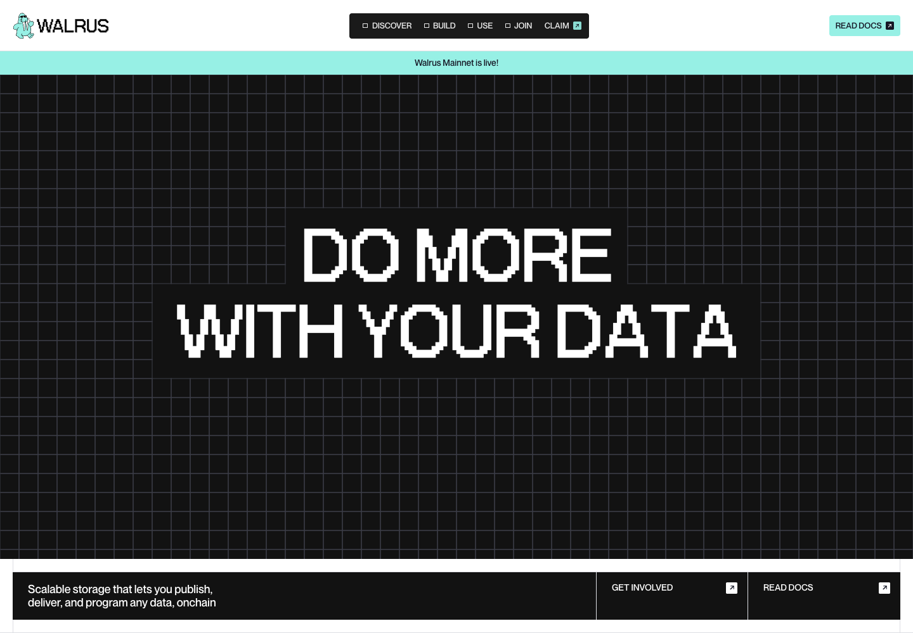

# Walrus — July 2025

A Next.js reconstruction of **walrus.xyz as it appeared in July 2025**, captured with [D-j-View](https://github.com/Nuel-osas/D-j-View) and the Internet Archive. The homepage uses the [July 14, 2025 snapshot](https://web.archive.org/web/20250714100230/https://www.walrus.xyz/).

Nine native App Router pages retain the original layout, pixel typography, illustrations, responsive styles, and July content. The reconstruction restores the interactive grid, animated headings, marquees, Lottie icons, menus, category filters, accordions, and scroll-driven sections. Images, fonts, styles, and animation dependencies are served locally.



## Run

Use Node.js 24 (see `.nvmrc`).

```sh
npm ci
npm run dev
```

Open http://localhost:3000. For a production preview:

```sh
npm run build
npm start
```

## Pages

| Route | Archived capture (UTC) |
| --- | --- |
| `/` | July 14, 10:02:30 |
| `/about` | July 14, 08:49:29 |
| `/blog` | July 14, 07:59:08 |
| `/news` | July 14, 10:01:53 |
| `/wal-token` | July 14, 09:45:03 |
| `/network-release-schedule` | July 14, 09:12:24 |
| `/rfp` | July 17, 17:13:17 |
| `/community` | July 26, 00:57:50 |
| `/get-started` | July 26, 00:57:50 |

Exact source links are recorded in [the source manifest](docs/source-manifest.json). The token-page capture includes the original `ref=blog.stakin.com` query parameter.

## Archive recovery

D-j-View captured the July homepage and 73 resources. The original replay could not load its hosted animation script, translation settings, form service, or several Lottie files. The reconstruction recovers missing assets from their original immutable CDN URLs and adapts the archived **July 26 animation script** to Next.js, with effect cleanup and reduced-motion support. It does not use the current site's replacement animation script.

- Blog filtering covers the 12 entries present in the saved page; news filtering covers 11 entries. Article, category, and further blog-page links open Wayback rather than implying a complete local editorial archive.
- External docs, community, ecosystem, and service links retain their original destinations.
- The newsletter form validates locally and explicitly reports that no subscription was sent. It is not connected to the original service.
- The external Google Calendar was not preserved. Its place contains a link to the archived schedule page.
- English is preserved; hosted translation, analytics, and tracking scripts are omitted.
- Duplicate navigation blocks in the captured HTML were consolidated. Menus and accordions have keyboard controls and accessible state. Content remains available without JavaScript.

The site is an independent historical reconstruction. Original Walrus content, artwork, logos, and fonts retain their respective owners' rights; no license over those materials is asserted here.

## Validation

```sh
npm run build
npm run typecheck
npx playwright-core install chromium
npm run test:browser
```

The browser test starts and stops a production server automatically. It checks all nine routes at desktop, mobile, and reduced-motion tablet sizes; local resources; image loading; horizontal overflow; menus; filters; FAQ controls; and the local-only newsletter response. It also checks content without JavaScript. Set `CHROME_PATH` for an installed Chrome/Chromium browser, `BASE_URL` for an existing server, or `SCENARIO=desktop` to run one viewport.

GitHub Actions runs the build and browser checks. Test screenshots and JSON results are uploaded as workflow artifacts. Local evidence is ignored under `.site-capture/`.

## Structure

- `src/app/` — routes and page metadata
- `src/components/pages/` — editable TSX page content
- `src/components/Navigation.tsx` and `Footer.tsx` — shared layout
- `src/lib/animations.js` — recovered July animation behavior with cleanup
- `src/lib/interactions.ts` — menus, filters, accordion accessibility, and form feedback
- `public/assets/` — locally served assets
- `public/styles/` — July styles and accessibility enhancements
- `docs/` — source and asset provenance

The pages are server-rendered React components; there is no iframe wrapper, raw-HTML injection, or hosted Webflow runtime.
